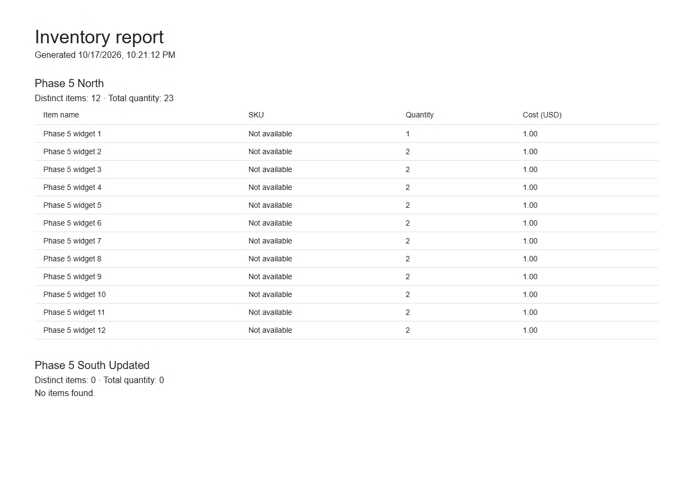
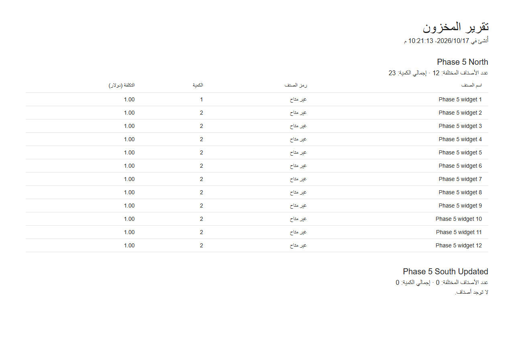

# Phase 7 web reviewer notes

This repository is the React/TypeScript/Vite client for the separate [Happy Inventory API](https://github.com/Anas-Abukhadir97/happy-inventory-api). The API repository owns the [reviewer guide](https://github.com/Anas-Abukhadir97/happy-inventory-api/blob/main/docs/reviewer-guide.md), canonical requirements, architecture and tested image pair. Both repositories are public and require no read invitation.

From a clean checkout, run `npm ci`, `npm run contract:check`, `npm run lint`, `npm run typecheck`, `npm run format:check`, `npm run test:coverage` and `npm run build`. The contract snapshot is pinned by SHA-256; a green contract check does not require the API to be running. For the browser/real-API test, clone the API as the sibling `backend/`, build it in Release, install Playwright Chromium, then run `npm run test:e2e` with ports 5080 and 5173 free. CI runs the same steps on Linux.

The screenshots below come from the Phase 5 isolated browser test fixture. They show the full inventory report across more than one API page, in English and right-to-left Arabic. Fixture names and generated timestamps are test data, not a live inventory or supplier record.

The browser holds access tokens in memory and uses the API's Secure HttpOnly refresh cookie. It supports Admin/Management writes, Auditor read-only inventory and reports, and Admin-only user/log screens. API authorization remains authoritative. The manual supplier request screen displays local outbox status; no real supplier receives a message. Browser automation checks the listed screens and axe serious/critical issues, but manual screen-reader and keyboard review is still a release limitation. Azure remains unprovisioned pending Phase 8 cost approval.
